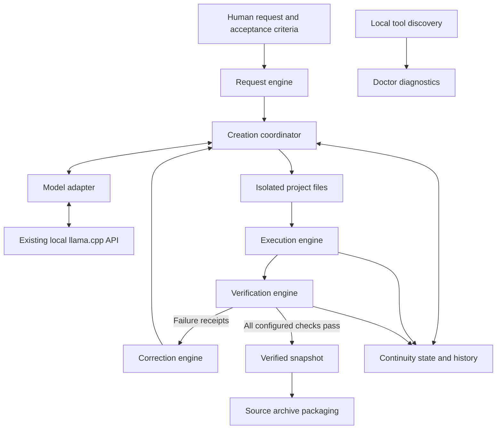

# Architecture

QASC separates human intent, model reasoning, and machine execution. The initial implementation is a Python package with a command-line interface, a local OpenAI-compatible model adapter, persistent project directories, and an execution and correction loop.

## Implemented foundation

| Module | Initial responsibility | Boundary |
| --- | --- | --- |
| Request | Preserve the human request and obtain structured requirements | Interpretation is model supplied; acceptance must be checked |
| Model | Probe the endpoint and exchange structured generation responses | One initial adapter; no external AI service required |
| Discovery | Report available local tools and versions | Discovery does not install tools or validate every language |
| Creation | Create a dedicated project and validate generated file paths | Initially Python applications using the standard library |
| Execution | Run the trusted QASC test runner with a working directory and timeout | Current-user processes; no operating system sandbox |
| Verification | Evaluate structured test results, execution receipts, and optional independent acceptance cases | Passing checks establish only the behavior they exercise |
| Correction | Send failures and compact project context back to the model | Bounded attempts and repeated-result detection |
| Packaging | Produce a source archive with recorded provenance | No executable compilation or installer in this release |
| Delivery | Return artifact locations and verification state | Installation and post-install checks remain planned |
| Continuity | Preserve requests, responses, state, receipts, and snapshots | Local disk is the source of resumable project state |

Commands coordinate these responsibilities; modules do not require separate background services. Tool discovery is exposed through `doctor`; initial creation selects the fixed Python standard-library stack and uses QASC's Python interpreter. Automatic stack selection and provisioning remain planned.

QASC consumes the already running server at `http://127.0.0.1:8080` by default. It never starts, stops, restructures, or modifies the reference installation at `I:\LocalAI`.

## Source layout

| Module | Public boundary |
| --- | --- |
| `src/qasc/cli.py` | Argument parsing, JSON reports, command exit codes |
| `src/qasc/model.py` | `ModelAdapter`, `Generation`, `OpenAICompatibleAdapter` |
| `src/qasc/discovery.py` | `discover_tools()` returns a read-only inventory |
| `src/qasc/project.py` | `Project` owns validated source paths, state, locks, and revisions |
| `src/qasc/execution.py` | `execute()` returns and optionally persists a process receipt |
| `src/qasc/runner.py` | Import standard-library unittest before project code, discover tests, and emit structured counts |
| `src/qasc/engine.py` | `Engine` coordinates generation, verification, and correction; `package_project()` builds source archives |

## Model boundary

The adapter is the boundary for model identity, context metadata when exposed, generation, structured response handling, tool-call requests, usage, timing, and errors. The first backend uses the llama.cpp OpenAI-compatible API. An absent metric is represented as unavailable rather than inferred. Model-returned tool calls are data; arbitrary model-selected commands are not an execution interface in the initial release.

See [docs/MODEL_ADAPTERS.md](docs/MODEL_ADAPTERS.md) for the concrete contract and extension direction.

## Project boundary

Each project has its own source tree and `.qasc` records. An existing target is not silently replaced. Generated paths are checked before writing, and QASC control files are separate from model-authored application files. Execution uses the intended project as its working directory.

These measures protect project organization. They do not make generated Python safe to run: a process with the user's permissions can access resources outside its working directory. Hardened execution isolation is a separate roadmap item.

## Feedback and verification

The model produces a structured proposal containing requirements, architecture, and files. QASC validates and persists the proposal, then executes configured checks when requested. Its trusted runner imports standard-library unittest before adding the generated project to its import path. Structured results supply actual test counts; console output is retained as diagnostic evidence. Zero tests, execution failures, incomplete captures, or file-inventory errors prevent a passing verification.

Each verification uses a fresh Python cache prefix and disables bytecode writes so rapid source corrections cannot accidentally execute an older cached module. Execution receipts retain stdout, stderr, exit status, timing, and timeout information before the engine decides whether a correction is needed.

Failure feedback contains bounded source context and the latest relevant receipts. The model returns file corrections, which are applied within the same project. Correction attempts are finite, and repeated ineffective output is surfaced as an unresolved condition.

Model-generated tests are useful checks, but their authorship limits their independence. Optional human-supplied acceptance cases provide checks the model cannot rewrite through the correction file interface. The initial model-authored tests are also frozen during correction. QASC records both the configured checks and their actual outcomes. A verified status means those checks passed, not that every possible behavior is proven.

## Persistent memory

The project state preserves the original request, interpretation, design, source inventory, execution results, correction history, failures, and verification status. Snapshots preserve earlier versions, including versions that passed verification. Resume reads this state instead of relying on a conversation session or resending its full history. Pending revision recovery validates snapshot and prior-source hashes before applying files; conflicting changes stop recovery. Atomic source replacement changes the project directory entry rather than writing through an existing hardlink.

See [docs/PROJECT_CONTINUITY.md](docs/PROJECT_CONTINUITY.md) for storage and recovery details.

## Future interfaces

Additional model adapters, stack-specific builders, package and installer backends, stronger process isolation, and an SCE integration should use explicit contracts and execution evidence. None should bypass provenance or mark planned functionality as delivered. SCE's actual interface has not been supplied; [docs/INTEGRATION_WITH_SCE.md](docs/INTEGRATION_WITH_SCE.md) describes the questions to resolve before implementation.
