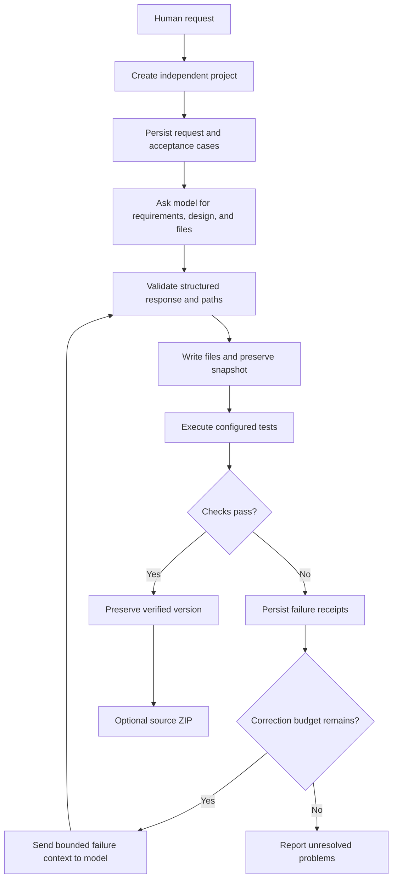

# Software creation workflow

QASC turns a request into a project with inspectable source and execution history. The initial workflow generates Python applications using only the standard library.

## Request and interpretation

The original request remains human-authored provenance. Model interpretation becomes structured requirements and architecture, stored alongside the request rather than replacing it. An ambiguous or omitted requirement cannot be proven satisfied simply because the generated tests pass.

Choose a new project name for a new application. Creation refuses to overwrite an existing project. Resume is the path for an interrupted existing task.

## Generation

Run `doctor` to inspect available tools and the model endpoint. Initial creation uses the fixed Python standard-library stack rather than selecting a language dynamically. It contacts the configured model and requests a structured response. The engine validates the response and generated paths before applying files. The raw model exchange is retained for diagnosis. Multiple files belong to the same dedicated project tree.

Generation alone is a separate result from execution. Creating source without running checks does not establish that the application works.

## Execution and independent checks

The engine launches QASC's trusted runner by absolute path. The runner imports standard-library unittest before admitting project modules, discovers `tests/test_*.py`, and writes structured test counts and outcomes. Verification uses those results together with the actual process receipt; zero tests and incomplete evidence fail verification. Optional external acceptance cases exercise behavior independently of model-authored tests. The model correction mechanism cannot replace these persisted cases or change the initial model-authored tests.

Generated projects must not contain a top-level `unittest.py` file or `unittest` directory. A fresh cache prefix and disabled bytecode writes prevent stale Python caches from reusing earlier source after a rapid correction.

Checks run with a timeout and the project's working directory. They run with the current user's operating system permissions. Review generated code and the execution constraints before running unfamiliar applications.

## Correction

When verification fails and corrections are enabled, QASC sends the relevant error output, compact project state, and bounded source context back to the model. The proposed file changes pass the same validation as initial generation. Each iteration produces an inspectable record and another actual execution.

The loop stops when configured checks pass, the correction budget is exhausted, a repeated ineffective result is detected, or a concrete execution or inference limitation prevents progress. A stopped loop preserves its failures rather than converting them into a success claim.

## Resume and delivery

Resume reconstructs context from the project on disk. It can retry interrupted generation or verification without requiring the original chat session. Verified snapshots remain available as evidence of earlier working versions.

The initial package operation creates a source ZIP only when the current source matches its passing verification. The archive includes managed source files and a `QASC-DELIVERY.json` manifest; QASC checks ZIP integrity and file hashes. Its contents still require a suitable Python runtime; the ZIP is neither a native executable nor an installer. Executable builds, installers, and post-install verification are later delivery backends.

Command examples are maintained in [README.md](../README.md). Storage details are in [PROJECT_CONTINUITY.md](PROJECT_CONTINUITY.md), and process behavior is in [EXECUTION_ENGINE.md](EXECUTION_ENGINE.md).
