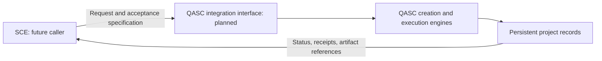

# Integration with SCE

SCE integration is a future objective. No authoritative SCE interface, repository, transport, or data contract has been supplied for this foundation. QASC does not currently communicate with SCE, and this document does not invent a working integration.

## Intended boundary

QASC should remain independently usable. A future SCE integration should submit a software request and acceptance specification, observe project status, inspect execution evidence, and retrieve verified delivery artifacts through explicit interfaces.

## Contract to establish before implementation

| Question | Required decision |
| --- | --- |
| SCE identity and ownership | Confirm the actual system and the integration owner |
| Request submission | Define transport, request identifiers, required fields, and idempotency |
| Authorization | Define who may request execution and access private project data |
| Lifecycle | Define queued, running, interrupted, failed, and verified status mappings |
| Acceptance | Identify who supplies checks and who may change them |
| Evidence | Define receipt formats, artifact references, and provenance fields |
| Recovery | Define retries, cancellation, timeouts, and resume semantics |
| Delivery | Define artifact transfer and separate installation verification |

The adapter should consume QASC's project and execution contracts rather than bypass them. SCE requests must retain the same project isolation, bounded execution, provenance, and truthful status semantics as local CLI requests.

An integration is complete only after a real end-to-end test has submitted a request, observed execution, retrieved an artifact, and inspected its acceptance evidence. Architecture diagrams and placeholder interfaces alone do not meet that criterion.
